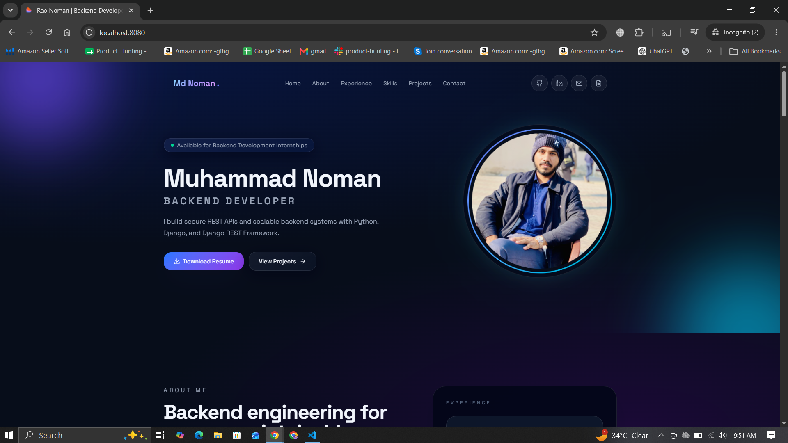
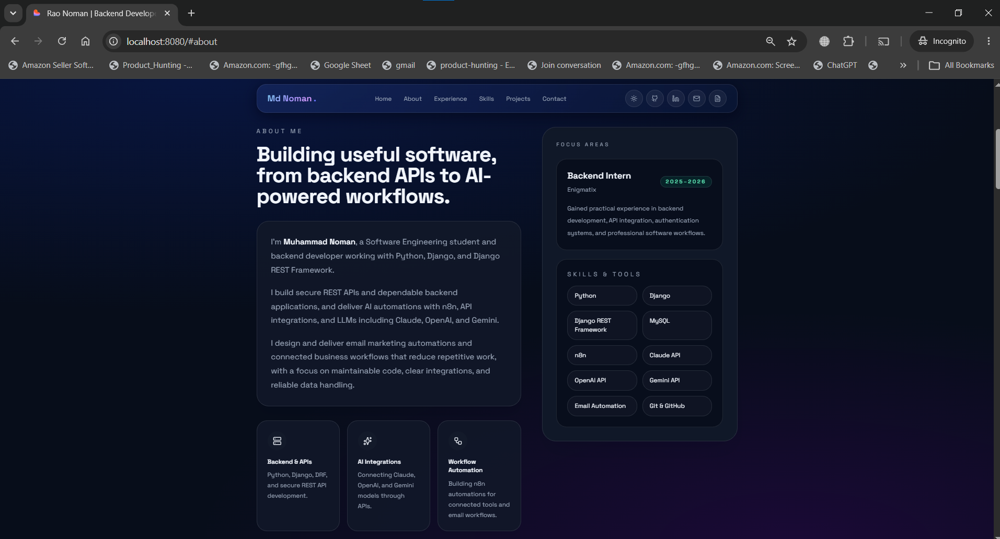
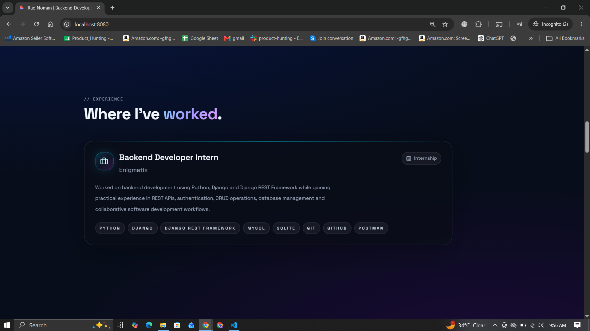
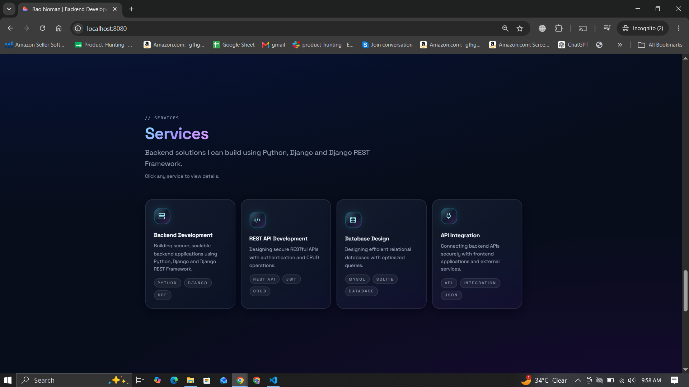
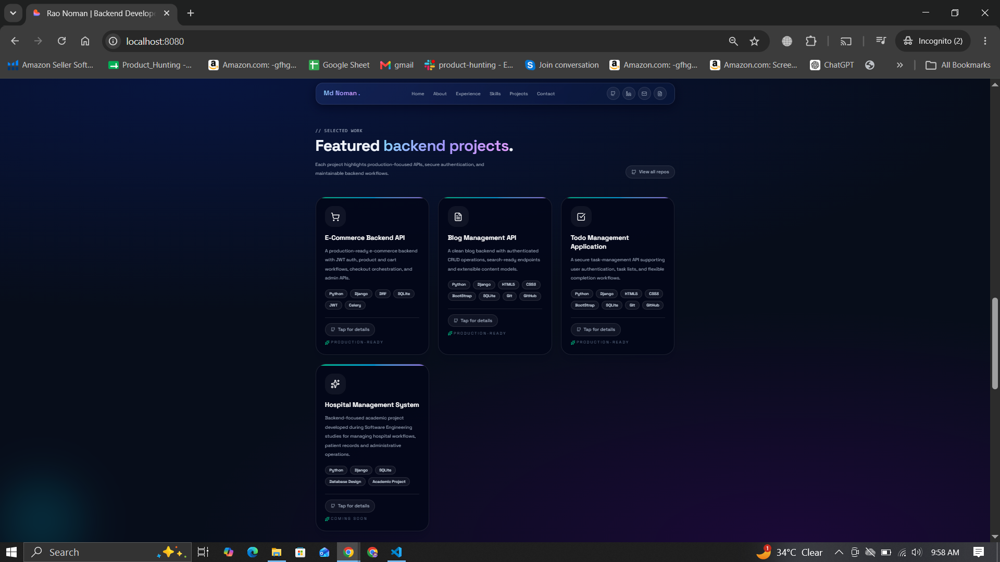
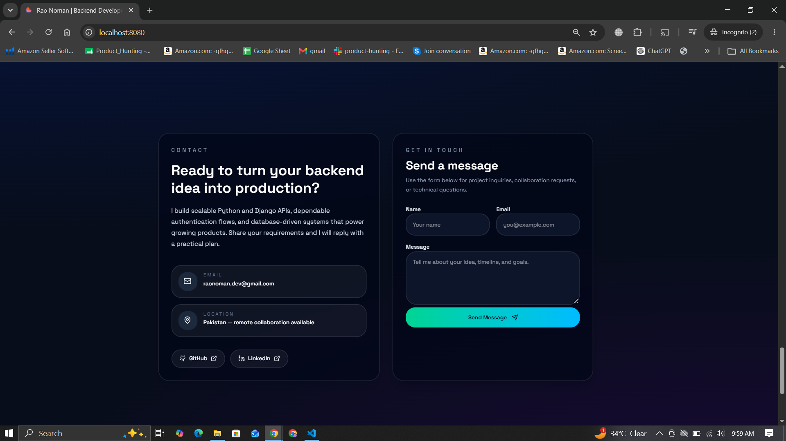

# 🚀 Muhammad Noman – Developer Portfolio

A modern full-stack developer portfolio built to showcase my skills, projects, and experience as a Backend Developer. The project features a responsive frontend with a Django-powered backend, a functional contact system, and PostgreSQL integration.

---

## 🌐 Live Demo

**Frontend:** Coming Soon

**Backend API:** Coming Soon

---

## ✨ Features

- Responsive Modern UI
- Dark Theme
- Smooth Animations
- About Section
- Skills Showcase
- Experience Timeline
- Services Section
- Featured Projects
- Functional Contact Form
- Django REST API
- PostgreSQL Database
- Clean Project Structure
- Production Ready

---

## 🛠 Tech Stack

### Frontend

- React.js
- TypeScript
- Vite
- Tailwind CSS
- Framer Motion

### Backend

- Python
- Django
- Django REST Framework
- PostgreSQL (Neon)

### Tools

- Git
- GitHub
- Postman
- VS Code

---

# 📸 Portfolio Preview

<p align="center">
  
</p>

<p align="center">
  
  
</p>

<p align="center">
  
  
</p>

<p align="center">
  
  
</p>

---

## 📁 Project Structure

```
Muhammad-Noman-Portfolio
│
├── backend/
│
├── frontend/
│
├── screenshots/
│   ├── home.png
│   ├── about.png
│   ├── experience.png
│   ├── skills.png
│   ├── services.png
│   ├── projects.png
│   └── contact.png
│
├── README.md
│
└── .gitignore
```

---

## ⚙️ Local Installation

### Clone Repository

```bash
git clone https://github.com/raonomandev/Muhammad-Noman-Portfolio.git
```

```bash
cd Muhammad-Noman-Portfolio
```

---

## Frontend Setup

```bash
cd frontend
npm install
npm run dev
```

Runs on:

```
http://localhost:5173
```

---

## Backend Setup

Create Virtual Environment

```bash
python -m venv env
```

Activate

Windows

```bash
env\Scripts\activate
```

Linux / macOS

```bash
source env/bin/activate
```

Install Dependencies

```bash
pip install -r requirements.txt
```

Run Migrations

```bash
python manage.py migrate
```

Create Superuser

```bash
python manage.py createsuperuser
```

Run Server

```bash
python manage.py runserver
```

Backend runs on:

```
http://127.0.0.1:8000
```

---

## 🔐 Environment Variables

Create a `.env` file inside the **backend** directory.

```env
SECRET_KEY=your_secret_key

DEBUG=True

DATABASE_URL=your_database_url

EMAIL_HOST=smtp.gmail.com
EMAIL_PORT=587
EMAIL_USE_TLS=True

EMAIL_HOST_USER=your_email
EMAIL_HOST_PASSWORD=your_app_password

DEFAULT_FROM_EMAIL=your_email
```

---

## 🚀 Future Improvements

- Authentication Dashboard
- Blog System
- Admin Analytics
- AI Chat Assistant
- Multi-language Support
- CMS Integration

---

## 👨‍💻 Author

**Muhammad Noman**

Backend Developer (Python | Django | DRF)

---

## 📫 Connect With Me

**GitHub**

https://github.com/raonomandev

**LinkedIn**

https://linkedin.com/in/raonomandev

**Email**

raonoman.dev@gmail.com

---

## ⭐ Support

If you found this project useful, please consider giving it a ⭐ on GitHub. It helps support my work and encourages future open-source contributions.

---

## 📄 License

This project is licensed under the MIT License.
